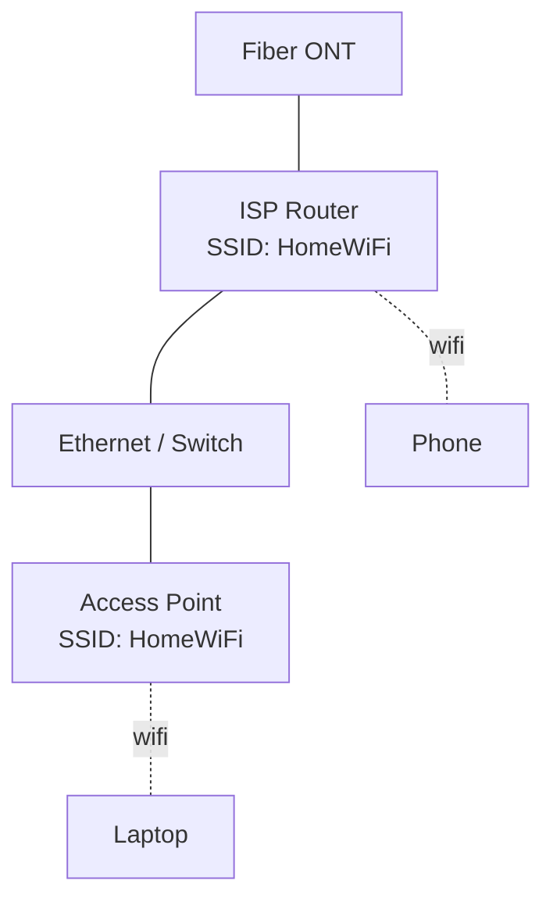
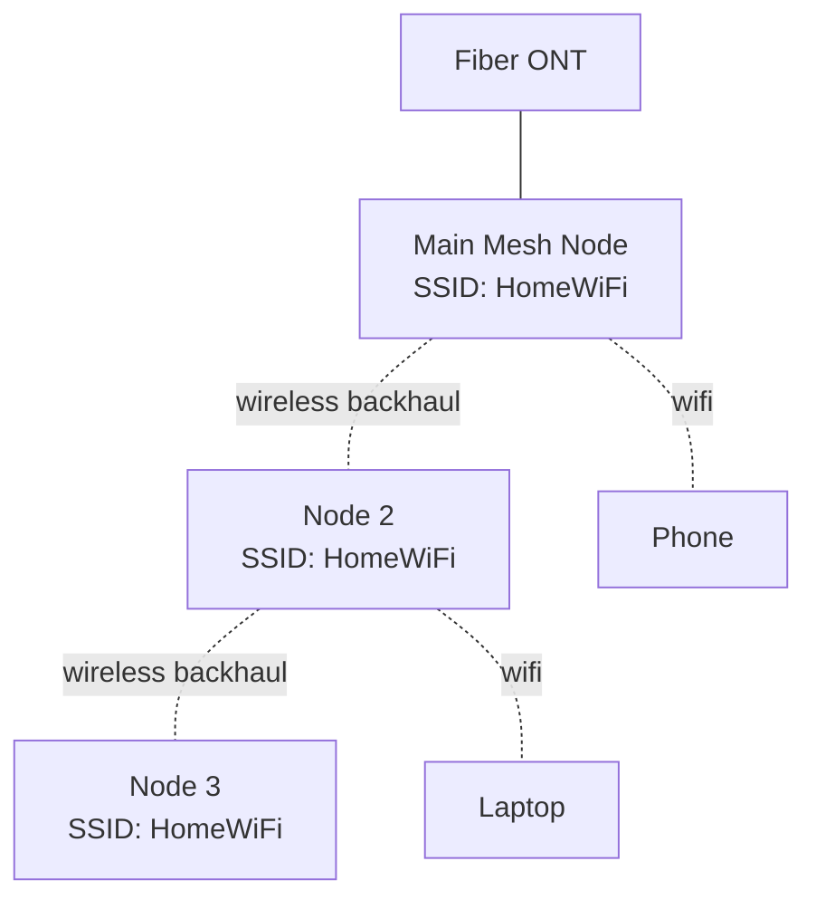
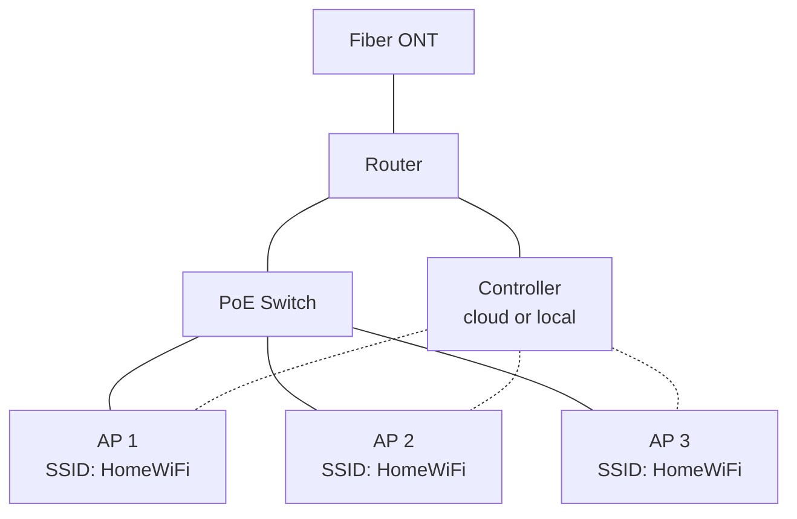

# 05 — Architecture Options

How you build a unified SSID network depends on how many APs you have and how you
manage them. This chapter covers the main topologies, from the simplest ISP router
to a multi-AP mesh or controller setup, with diagrams.

## Option A — Single router, unified bands (the baseline)

The stock ISP router broadcasts one SSID across its own 2.4 GHz and 5 GHz radios.
This is already a unified SSID, limited to one device location.

```mermaid
graph TD
    ONT[Fiber ONT] --- R([ISP Router<br/>SSID: HomeWiFi<br/>2.4 + 5 GHz])
    R -.2.4 GHz.- C1[Phone]
    R -.5 GHz.- C2[Laptop]
```

- **Pros:** zero extra hardware, one SSID, band steering often built in.
- **Cons:** coverage limited to one spot; no roaming because there is only one AP.
- **Best when:** a small apartment and the router is centrally placed.

## Option B — ISP router + one AP in bridge/AP mode

Disable wi-fi on the ISP router (or leave it) and add a second access point
connected by Ethernet, using the **same SSID and password**. This creates two
BSSIDs under one ESSID and introduces real roaming.



- **Pros:** best performance for the money; wired backhaul.
- **Cons:** the ISP router and the AP may not coordinate roaming; each manages
  its own clients. k/v/r often unavailable.
- **Tip:** turn the AP's routing/DHCP **off** (AP/bridge mode) so only one device
  hands out IP addresses. Two routers both doing DHCP/NAT is a common misconfig.

## Option C — Mesh system

Multiple nodes with a wireless (or mixed) backhaul, usually managed as one system
via an app. They present a single SSID and coordinate roaming internally.



- **Pros:** easiest roaming, one app, single SSID by design.
- **Cons:** wireless backhaul costs airtime; vendor lock-in; some kits have
  limited advanced settings.
- **Tip:** where possible, wire the nodes ("Ethernet backhaul") for a
  significant speed and stability boost. Many mesh kits support this.

## Option D — Controller-based (prosumer / enterprise)

A central controller coordinates many APs, handling roaming (k/v/r), power/channel
tuning, and per-device policies.



- **Pros:** best roaming and tuning, scalable, unified policy.
- **Cons:** cost, complexity, more setup.
- **Best when:** large home, office, or any environment where roaming really
  matters.

## Controller vs controllerless

| Aspect            | Controllerless (independent APs)         | Controller / mesh                          |
| ----------------- | ---------------------------------------- | ------------------------------------------ |
| Setup             | Each AP configured separately            | Central, one config                        |
| Roaming           | Depends on client and luck; k/v/r rare   | Coordinated, k/v/r possible                |
| Settings drift    | Rises over time (each AP diverges)       | Consistent across all APs                  |
| Cost              | Lower                                    | Higher                                     |
| Best for          | One AP added to ISP router               | 2+ APs, larger spaces                      |

## Backhaul choices

| Backhaul              | Speed / latency         | Effort            | Notes                                  |
| --------------------- | ----------------------- | ----------------- | -------------------------------------- |
| Ethernet (wired)      | Best                    | Hardest (cabling)| Strongly preferred where feasible      |
| MoCA / powerline      | Decent                  | Medium            | Uses existing coax/power wiring        |
| Dedicated wireless    | Good                    | Easy              | Mesh with a dedicated backhaul radio   |
| Shared wireless       | Fair (halves airtime)   | Easy              | Entry-level mesh                       |

## Avoiding the double-NAT trap

When adding your own router behind the ISP router, you can end up with two layers
of NAT (network address translation). Symptoms: port forwarding fails, some games
and services misbehave, and devices on different subnets cannot see each other.

Fixes, in order of preference:

1. Put your own device in **AP/bridge mode** (recommended when the ISP router
   must stay as the router). It then just extends the LAN — no second NAT.
2. Put the ISP device into **bridge mode** and let your router do the routing (if
   the ISP allows it).
3. If neither is possible, keep everything on the ISP router and only add APs,
   not routers.

More on the ISP-specific quirks in
[setup/02-isp-routers.md](../setup/02-isp-routers.md).

## Choosing an option

- Small apartment, one room of concern → **Option A**.
- House with dead spots, willing to run one cable → **Option B**.
- House with no easy cabling, want simplicity → **Option C**.
- Large home/office, want full control → **Option D**.

## Next

- Security layers: [06-security.md](06-security.md)
- Setup steps: [setup/01-generic-setup.md](../setup/01-generic-setup.md)
- <a id="architecture-verify"></a>Checklist:
  - How many APs/nodes do you actually need?
  - Can any of them be wired?
  - Is anything double-NATing (two DHCP servers / two subnets)?
