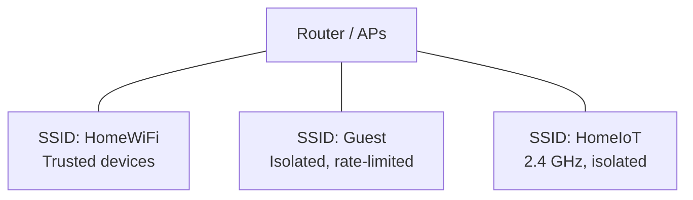

# 06 — Security Fundamentals

A unified SSID means one password for a whole network. That convenience has
security implications. This chapter covers the settings to choose and when to add
separate SSIDs.

## Encryption and authentication modes

| Mode                        | What it is                                          | Compatibility                     |
| --------------------------- | --------------------------------------------------- | --------------------------------- |
| WPA2-Personal (AES)         | Password-based (PSK); universal                     | Almost everything                 |
| WPA3-Personal (SAE)         | Stronger handshake, forward secrecy                 | Modern devices only               |
| WPA2/WPA3 mixed (transition)| Allows both                                         | Broad, with WPA3 where possible   |
| WPA3-Enterprise / 802.1X    | Per-user credentials via a server (RADIUS)          | Managed environments only         |
| Open (no encryption)        | No protection                                       | Avoid; use a captive portal instead |

**Recommendation for most homes:** WPA2/WPA3 mixed mode. It lets modern devices
use WPA3 while legacy devices still connect. Use WPA3-only only if every device
you care about supports it.

Avoid the older **TKIP** and **WEP** options entirely; they are obsolete and
insecure. Always prefer **AES** (sometimes labeled CCMP).

## One password, one network — the tradeoffs

A unified SSID uses a single password (PSK) shared by all devices. That is easy,
but:

- If one device's password leaks, the whole network is at risk until you change
  it everywhere.
- You cannot revoke one device without changing the password for all.
- Guests get the same access as your trusted devices unless you separate them.

For a home, a strong single password is usually acceptable. For offices and
shared spaces, per-user authentication (802.1X) is worth the complexity.

## Separate SSIDs for separation of concerns

Unification is about making one network *seamless*. It does not mean you must have
only one. Good practice is a small number of purpose-built SSIDs:

- **Main SSID:** trusted devices; WPA2/WPA3; full LAN access.
- **Guest SSID:** visitors; isolated from the LAN; often bandwidth-limited.
- **IoT SSID:** smart devices; often 2.4 GHz-only; ideally on its own VLAN.

Each of these should itself be **unified** across all bands and APs. A guest SSID
that only exists on one AP is a bad guest experience.

## Guest network isolation

The key setting is usually called **AP isolation**, **client isolation**, or
**guest network isolation**. It prevents clients on that SSID from talking to
each other and, ideally, from reaching your main LAN. On stock ISP routers the
guest network is often isolated by default; verify it.

Checklist for a guest SSID:

- Enabled on **all** APs (same name/password).
- Client/AP isolation **on**.
- Bandwidth cap (optional but polite).
- No access to router admin or LAN devices.

## IoT security

Smart devices are often the weakest link: infrequent updates, old TLS, and
sometimes cloud services you do not control.

- Put them on their own SSID/VLAN where possible.
- Don't let IoT reach trusted devices if you can avoid it.
- Use a modern security mode if the devices support it; otherwise isolate the
  weaker ones on a dedicated SSID.
- Change default admin passwords on cameras and hubs.

## WPA3 and legacy devices

WPA3 is the strongest common option but old gear may refuse it. Two strategies:

1. **Mixed mode** on the main SSID. Best balance for mixed homes.
2. **WPA3-only on main, WPA2 on a legacy/IoT SSID.** More control, more setup.

If a device fails to connect right after you enable WPA3-only, mixing or
separating is usually the fix.

## Additional hardening

- Disable **WPS** (Wi-Fi Protected Setup) — it is convenient but has known
  weaknesses.
- Disable remote administration of the router from the WAN unless needed.
- Change the default router admin password.
- Keep router firmware updated; ISP routers may need a manual check or a support
  request.
- Use a long, unique wi-fi password; avoid reusing the router admin password.
- Consider a separate admin/management network in larger installs.

## The relationship to unified SSID design

- Unify the **main** network across bands/APs.
- Add isolated, also-unified **guest** and **IoT** networks as needed.
- Choose the *strongest security mode that all devices on that SSID support*.
- Keep the security settings **identical** across APs for each SSID — mismatched
  security is a common cause of "can't connect on the second AP".

## Next

- Troubleshooting: [07-troubleshooting.md](07-troubleshooting.md)
- Setup steps: [setup/01-generic-setup.md](../setup/01-generic-setup.md)
- Checklist:
  - Security mode chosen (WPA2/WPA3 mixed recommended)?
  - WPS disabled?
  - Guest SSID isolated and present on all APs?
  - IoT devices separated where feasible?
