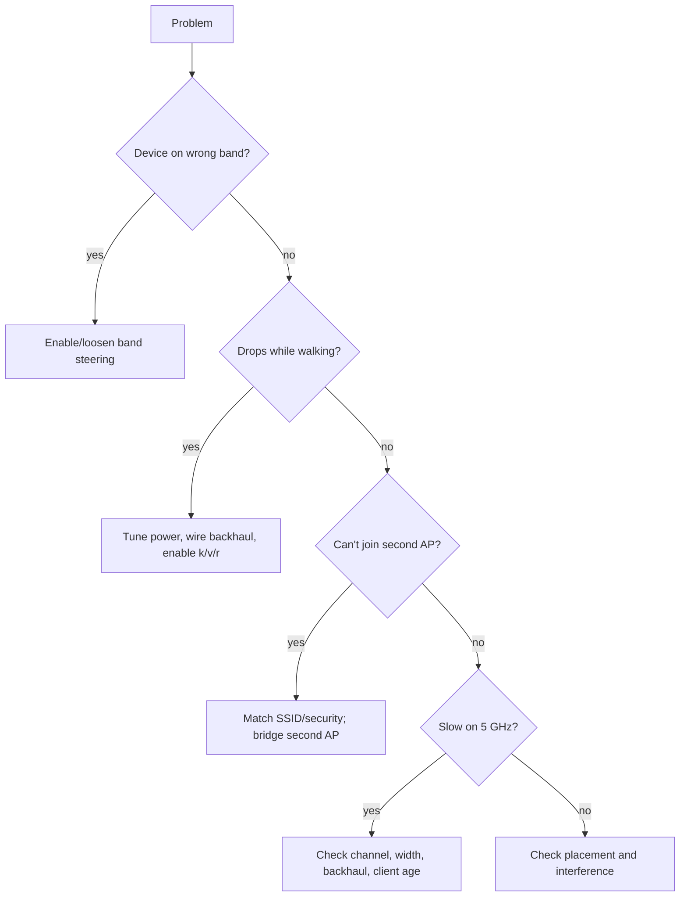

# 07 — Troubleshooting

When a unified SSID setup misbehaves, the cause is usually one of a handful of
issues. This chapter lists symptoms, likely causes, and fixes.

## Diagnostic toolkit

- **Wi-Fi analyzer app** (phone/laptop): shows SSIDs, BSSIDs, channels, signal
  strength (RSSI), and which BSSID you are attached to.
- **Continuous ping:** `ping -t <gateway>` (Windows) or `ping <gateway>` (macOS/
  Linux) while walking around; watch for drops.
- **Speed test** per band/location.
- **Router admin pages** for channel, power, and client lists.
- **Notes:** record BSSIDs and channels per location to spot problems.

## Symptom: device stays on 2.4 GHz near the router

**Cause:** band steering off, weak steering implementation, or a client that
ignores steering.

**Fixes:**
- Confirm band steering / "Smart Connect" is enabled.
- Confirm the SSID is truly unified (same name/security on both bands).
- Update the client device firmware.
- If the client still refuses and performance suffers, give it a dedicated 2.4
  GHz or 5 GHz SSID.

## Symptom: choppy call or drops while walking

**Cause:** sticky client — the device holds a distant AP too long; or roaming
protocols are unsupported.

**Fixes:**
- Reduce AP transmit power so cells overlap less.
- Add an AP closer to the problem area.
- Prefer wired backhaul over wireless mesh hops.
- Enable 802.11k/v/r if your hardware supports it.
- Raise minimum-RSSI/kick-out threshold gradually, if available.

## Symptom: can't connect on the second AP

**Cause:** security settings or SSID differ between APs; band steering too
aggressive; or the second device is routing instead of bridging.

**Fixes:**
- Make SSID, password, and security mode **byte-for-byte identical**.
- Ensure the second AP is in **AP/bridge mode** (DHCP and NAT off).
- Loosen or disable band steering and retest.
- Check that the second AP's band supports the client (e.g. a 2.4-only device
  cannot join a 5-only SSID).

## Symptom: two networks appear with the same name

**Cause:** the SSID is shared but security differs, or they are genuinely two
different networks (e.g. two routers each doing NAT).

**Fixes:**
- Match security settings exactly.
- Eliminate double-NAT: put one device in AP/bridge mode (see
  [05-architecture.md](05-architecture.md)).

## Symptom: no internet on devices behind the second router/AP

**Cause:** double-NAT, or the second device is not bridged and hands out its own
conflicting subnet.

**Fixes:**
- Switch the second device to AP/bridge mode.
- Or configure bridge mode on the ISP router if permitted.
- Verify only one device is running DHCP.

## Symptom: slow speeds even on 5 GHz

**Causes and fixes:**
- **Channel congestion:** scan and pick a clear channel; use 80 MHz width on
  5 GHz if the environment is clean.
- **2.4 GHz overlap:** keep 2.4 GHz at 20 MHz and use channels 1, 6, or 11 only.
- **Steered too early:** a client pushed to 5 GHz at long range gets poor
  throughput — tune thresholds.
- **Wireless backhaul bottleneck:** wire the mesh nodes if possible.
- **Old client:** some devices simply cannot use faster rates; verify the
  client's capabilities.

## Symptom: IoT devices won't join

**Causes:** 2.4 GHz-only devices meeting a merged/steered SSID; WPA3-only security;
band steering too aggressive.

**Fixes:**
- Create a dedicated **2.4 GHz-only IoT SSID** with WPA2.
- Temporarily disable band steering to onboard the device, then re-enable.
- Some devices require onboarding in AP mode with a phone app on the same 2.4 GHz
  network — check the device instructions.

## Symptom: coverage varies wildly room to room

**Cause:** AP placement and power.

**Fixes:**
- Place APs centrally and high, away from metal, mirrors, aquariums, and concrete
  walls.
- Do not stack APs; space them so coverage overlaps moderately.
- Lower power rather than raising it; higher power makes clients stick to the
  wrong AP.
- Add an AP where the dead spot is, not at the far end from it.

## Symptom: settings keep getting lost / can't change them

**Cause:** ISP-provided routers often have locked or limited firmware.

**Fixes:**
- Confirm what your model actually permits (see
  [setup/02-isp-routers.md](../setup/02-isp-routers.md)).
- If the feature is unavailable, add your own AP/mesh in bridge mode and manage
  wi-fi there.
- Contact the ISP only if the router itself misbehaves.

## A quick decision flow

## Next

- Setup walkthroughs: [setup/00-prerequisites.md](../setup/00-prerequisites.md)
- Checklist:
  - Symptom categorized using the flow above?
  - SSID/security confirmed identical across APs?
  - Only one DHCP server on the network?
