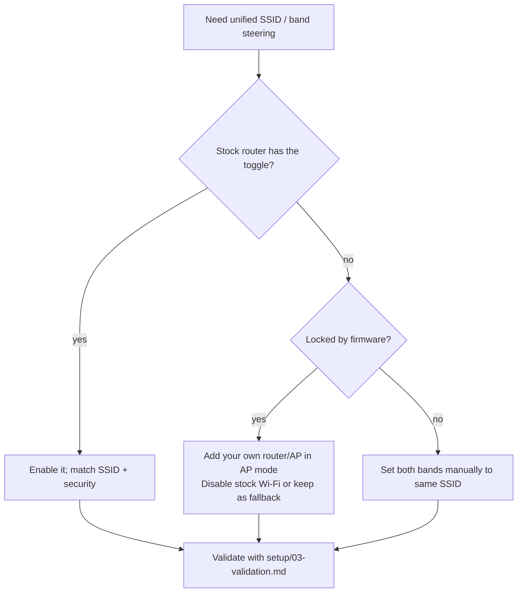

# Setup 02 — Philippine ISP Routers (PLDT, Globe, Converge)

Stock ISP routers can usually do a unified SSID, and many ship with band steering
already on. The catch: menus, labels, and available features differ by brand,
model, and firmware revision. This chapter describes where the settings
generally live for **PLDT Home Fibr**, **Globe At Home**, and **Converge**, plus
the common workarounds when a feature is locked or missing.

> Important caveat: credential defaults and menu paths below are *commonly
> reported patterns*, not guarantees. Always check the sticker on your device
> first. Firmware updates by the ISP can move or rename options without notice.
> Do not change WAN/PPPoE/fiber settings — only wireless ones.

## Before you start

- Confirm your gateway address (see [00-prerequisites.md](00-prerequisites.md)).
- Record your current SSID(s), password, and security mode.
- Prefer a wired connection while reconfiguring.
- Keep the old password until the new settings are proven working.

## Feature reality check on ISP firmware

| Feature                         | Usually available?                         |
| ------------------------------- | ------------------------------------------ |
| Change SSID / password          | Yes                                        |
| Separate 2.4 / 5 GHz SSID names | Yes                                        |
| Unified SSID (one name)         | Yes on most dual-band models               |
| Band steering / "Unified Band"  | Yes on many, hidden on some                |
| Guest network                   | Sometimes                                  |
| AP / bridge mode                | Sometimes (often locked)                   |
| 802.11k/v/r                     | Rarely exposed                             |
| Per-band channel / width        | Sometimes                                  |
| Advanced/full admin settings    | Locked; may require `adminpldt`/superadmin |

The practical pattern: if the feature you want is locked, **add your own
AP/mesh in AP mode** and manage the unified SSID there. This is almost always
easier and better than fighting locked firmware.

---

## PLDT Home Fibr

### Logging in

- Common gateway: `192.168.1.1`. Some models also accept
  `https://pldthomewifisettings.net`.
- Default admin credentials **commonly** seen: username `admin`, password `1234`
  (older models) or `admin` / `pldthome` (some newer models). Check your sticker.
- PLDT routers often have **multiple accounts**: a limited `admin` and a fuller
  `adminpldt` / superadmin account. Full access sometimes requires enabling a web
  admin switch first, or may be restricted.
- If a browser warns about the certificate, proceeding is normal on these devices
  (self-signed certificates). Only do so if you are on your own LAN.

### Where the wi-fi settings are

Paths vary by model and chipset. Common ones:

- **Huawei-based ONTs:** top menu **WLAN** → **2.4G Basic Network Settings** and
  **5G Basic Network Settings** → edit **SSID Name** and **WPA PreSharedKey**.
- **FiberHome-based ONTs (e.g. AN5506):** **Network** → **2.4G Basic / 5G Basic**
  (some firmwares: **Basic** → **Wireless LAN (WLAN) Settings**), then set the
  SSID and WPA-2 PSK password. The limited account may only allow one band at a
  time.
- Some models expose SSID/password only through a **setup wizard** on first login
  or a mobile app.

### Making it unified on PLDT

1. Set the **2.4 GHz SSID** to your chosen name.
2. Set the **5 GHz SSID** to the **exact same name** and the **same password**.
3. If a **"Band Steering"** / **"Smart Connect"** / **"Unified Band"** toggle
   exists, turn it **on** (it may grey out one SSID field).
4. Save/apply and reconnect.

### PLDT limitations and notes

- Band steering is present on many dual-band PLDT ONTs but can be weak; some
  clients still stick to 2.4 GHz.
- 802.11k/v/r is generally **not exposed**.
- LAN ports 2–4 and advanced settings are sometimes disabled on the standard
  account. Enabling them historically required a superadmin/Debug account or
  physical console access — those are **undocumented, may void support, and can
  break your service**. This guide does not recommend them.
- If you need real roaming/steering, put the PLDT ONT in bridge mode (if allowed)
  or place your own router/AP behind it in AP mode.

---

## Globe At Home

### Logging in

- Common gateway: `192.168.254.254`.
- Default credentials commonly reported: username `user`, password `@l03e1t3`
  (some Huawei Globe modems use `user` / `tattoo@home`). Check your sticker.
- Newer Globe modems and prepaid Wi-Fi devices may expose settings under an
  **Advanced** tab with a different layout.

### Where the wi-fi settings are

Paths vary by model:

- **Classic Huawei Globe modem:** **Network** → **WLAN Settings** → **Advanced**
  (2.4 GHz) and **5G Advanced** (5 GHz). Set **SSID Name**, **Security Mode**
  (WPA-PSK/WPA2-PSK), **WPA Algorithms** (AES), and **Passphrase**.
- **Newer / prepaid models:** **Wifi Settings** → **Basic** (and its 5 GHz
  counterpart), or **Advanced** → **Wi-Fi Basic Settings**.

### Unified Band Settings (Globe's band steering)

Some Globe modems expose a dedicated **Unified Band Settings** tab:

1. Go to **Wifi Settings** → **Basic** (or the equivalent wireless section).
2. Open the **Unified Band Settings** tab.
3. Turn **ON** the **Wi-Fi Band Steering Switch**.
4. Set the unified network name and password for both bands.
5. Apply and reconnect.

When band steering is **off**, the two bands keep **separate** SSIDs (the 5 GHz
one typically gets a suffix). This is useful as a temporary troubleshooting step,
but it is not a unified SSID.

### Globe limitations and notes

- A known issue on some Globe 5 GHz defaults is **WPA/WPA2 with TKIP**, which is
  weak. If you change the 5 GHz band to **WPA2/WPA3-AES** and a device can no
  longer see or join the SSID, the device may be the problem — or the band may be
  finicky post-change. Test with one modern device before committing.
- If the 5 GHz SSID "disappears" after a security change, revert, confirm the
  band works, then change again more carefully, applying one field at a time.
- Like PLDT, deep/advanced settings may be locked; prefer adding your own AP in
  AP mode for features the Globe modem lacks.

---

## Converge ICT

### Logging in

- Converge commonly issues **Huawei ONTs** (e.g. HG8145V5, HG8245 family) and
  sometimes other vendors.
- Common gateway: `192.168.1.1` (some Huawei models use `192.168.100.1`).
- Commonly reported admin credentials for Huawei-based units:
  `telecomadmin` / `admintelecom`, and on some Converge units
  `telecomadmin` / `Converge@huawei123`. Check your sticker; credentials vary.
- The limited user account may expose only basic wi-fi settings.

### Where the wi-fi settings are

- **Huawei ONT:** top menu **WLAN** → **2.4G Basic Network Settings** and
  **5G Basic Network Settings**.
- Under **SSID Configuration Details**, edit **SSID Name** (network name) and
  **WPA PreSharedKey** (password).
- Security is typically **WPA/WPA2 PreShared Key**; choose AES where offered.
- Click **Apply** per band. If one SSID field (or a combined/steering option) is
  shown, that firmware already manages both bands together.

### Making it unified on Converge

1. Set 2.4 GHz and 5 GHz to the **same SSID** and **same password**.
2. If a combined "SSID" or band-steering option exists, enable it.
3. Apply per band and reconnect.
4. If you cannot change the 5 GHz SSID on the user account, try the
   `telecomadmin` account, or add your own AP in AP mode.

### Converge limitations and notes

- Band steering availability depends on the ONT model/firmware; some expose only
  separate band controls.
- Advanced/enterprise options are often hidden behind `telecomadmin`.
- As with the others, do not touch WAN/PPPoE settings.

---

## TP-Link Aginet ONTs (used by some ISPs)

Some ISP deployments use **TP-Link Aginet** ONTs. Their **Band Steering** setting
works like this:

- **On:** one network name for both bands; the device picks the stronger signal.
- **Off:** the 5 GHz SSID automatically gets a `_5G` suffix (customizable), and
  you choose bands manually.

If you see a `_5G` suffix appear after toggling something, you have turned band
steering off. Turn it back on (and re-match the SSIDs) to restore a unified SSID.

---

## When the stock router can't do what you need

Use this decision guide:

### Adding your own AP behind an ISP router

1. Get an access point or mesh node (ideally one that supports AP/bridge mode).
2. Connect it to the ISP router by **Ethernet** where possible.
3. Set it to **AP / bridge mode**; **disable its DHCP server**.
4. Configure the **same SSID, password, and security** as the ISP router (if you
   keep the ISP Wi-Fi on) — or, better, disable ISP Wi-Fi and let your AP handle
   everything.
5. Give the AP a fixed LAN IP outside the ISP router's DHCP pool.
6. Place it near the dead spot, not at the far end of the house.

This avoids double-NAT and gives you the k/v/r and steering controls stock
firmware often hides. See
[../docs/05-architecture.md](../docs/05-architecture.md).

## Warnings

- **Do not** disable WAN/PPPoE/fiber or change VLAN settings; you can lose
  internet and require an ISP visit.
- **Do not** attempt superadmin/Debug unlock methods on ISP equipment unless you
  accept the risk: they can void support, break provisioning (TR-069), or violate
  your service terms.
- ISP firmware may reset your changes during remote maintenance. Keep a record.

## Next

- Validate your result: [03-validation.md](03-validation.md)
- Checklist:
  - Logged in with the correct account for your model?
  - 2.4 and 5 GHz SSID + password match exactly?
  - Band steering / Unified Band toggle found and enabled?
  - If locked, is adding your own AP in AP mode a better path?
